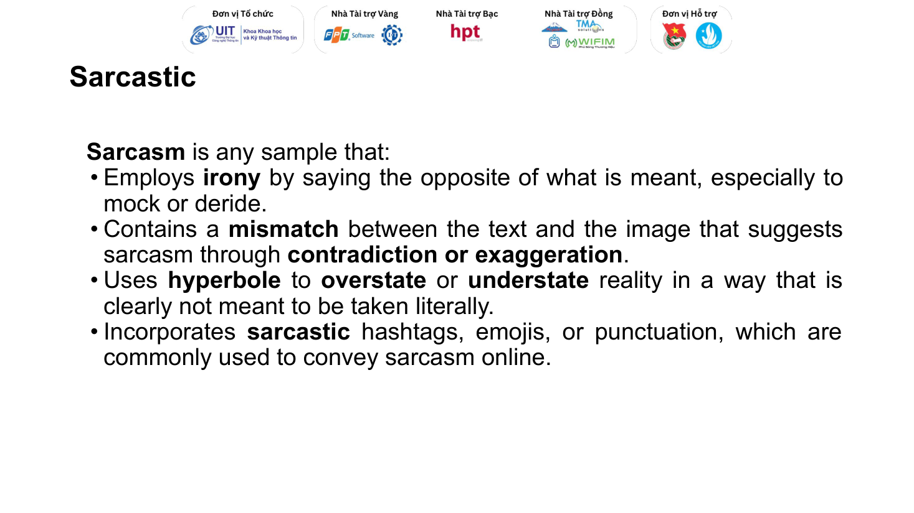
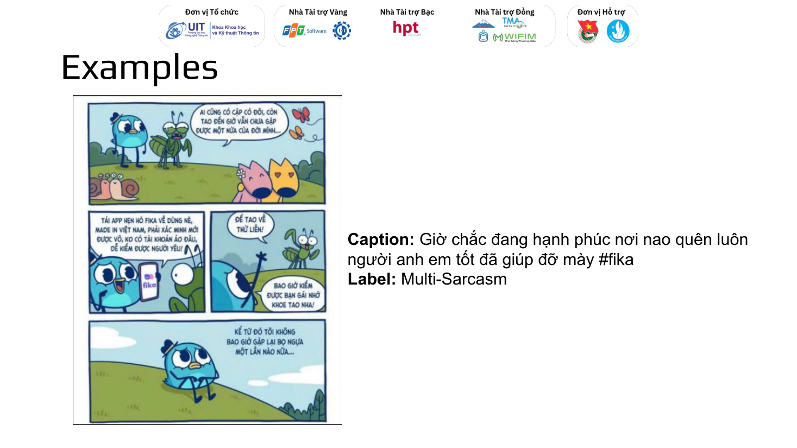
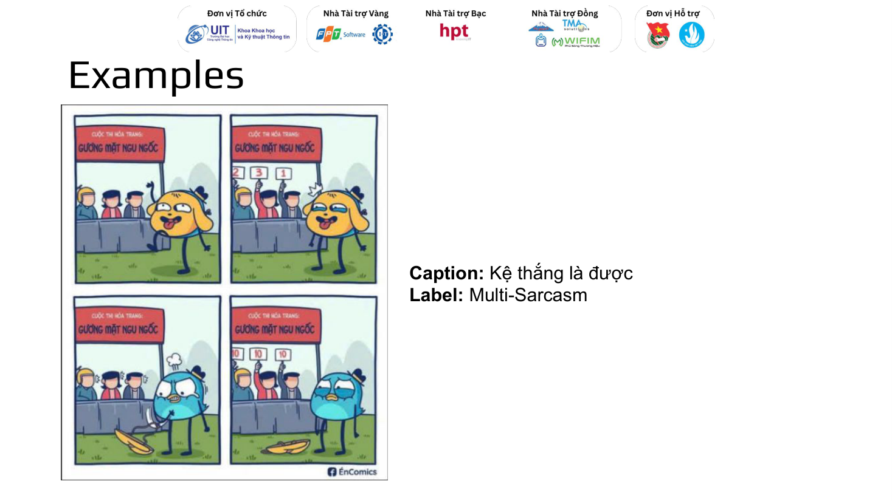
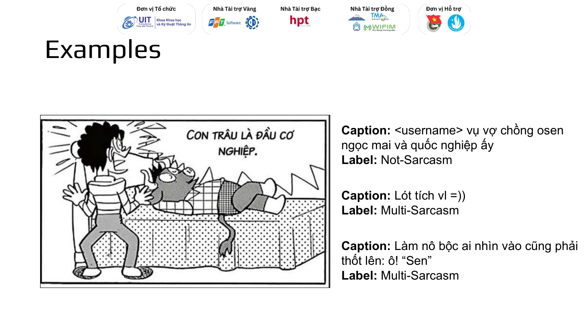
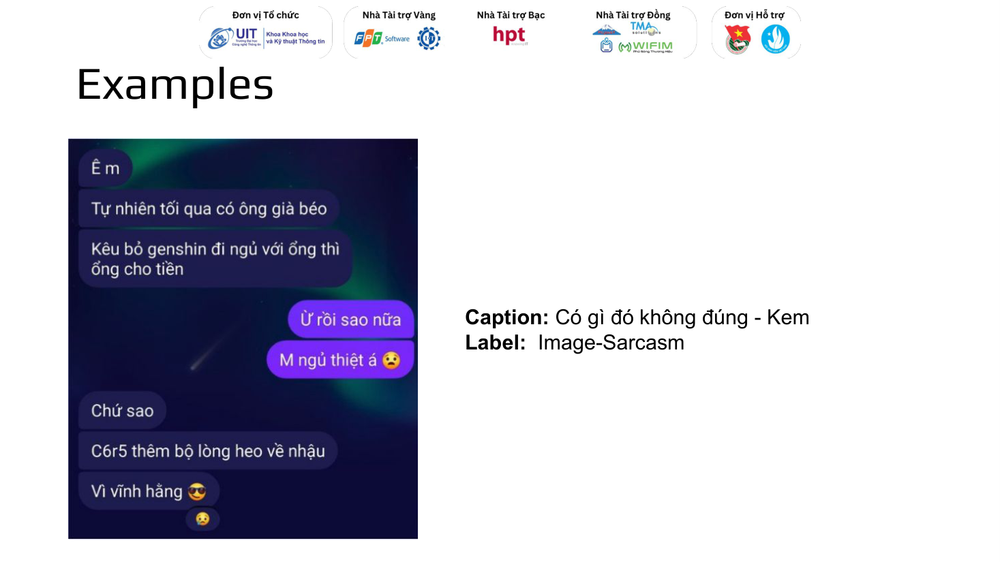
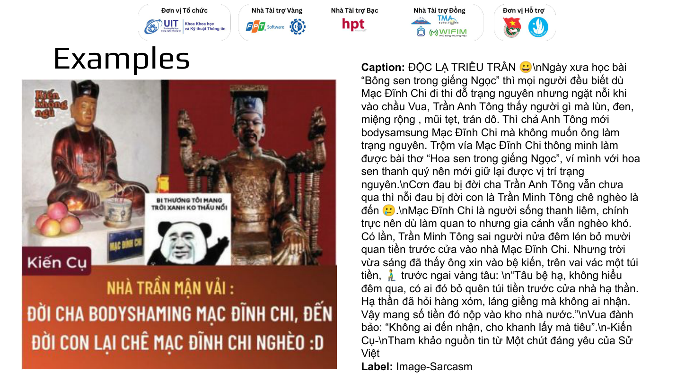
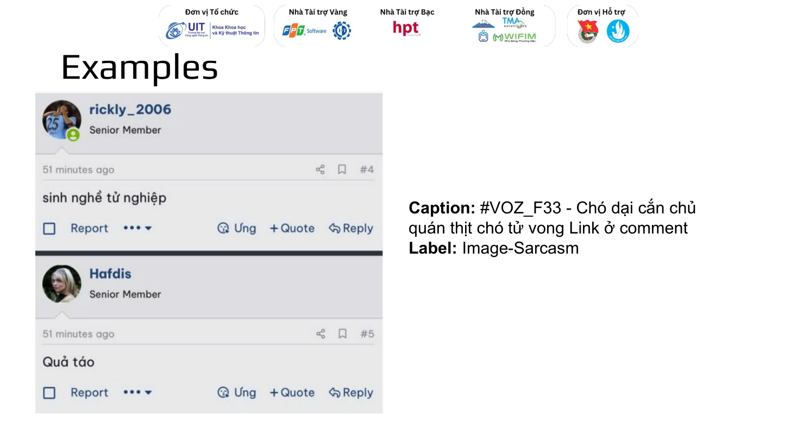
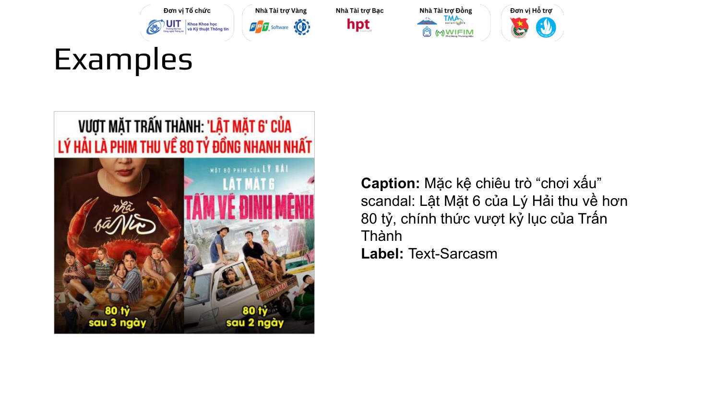

# Hướng dẫn gán nhãn chính thức của ViMMSD (UIT Data Science Challenge 2024)

Nguồn: `data/annotation-guideline.pdf`, 10 slide, xuất từ file trình chiếu `MMDS-introduction.pptx` của ban tổ chức UIT Data Science Challenge 2024. Ảnh từng slide nằm trong `docs/annotation_guideline_images/`.

Tài liệu này chép lại toàn bộ nội dung của bản gốc, kèm giải thích. Phần chép lại (định nghĩa, caption, nhãn) giữ nguyên văn. Các phần **Giải thích**, **Quy tắc suy ra** và **Đối chiếu** là diễn giải của nhóm, không phải của ban tổ chức.

So với `docs/labeling_guidelines.md`: tài liệu đó do nhóm tự dựng từ vài mẫu trước khi có bản chính thức. Mục 8 bên dưới so sánh hai bản.

---

## 1. Tóm tắt

- Bản chính thức chỉ định nghĩa **có châm biếm** và **không châm biếm** (slide 2, 3). Nó **không định nghĩa** ranh giới giữa `text-sarcasm`, `image-sarcasm` và `multi-sarcasm`. Ba nhãn này chỉ được minh hoạ bằng 9 ví dụ (slide 4–10).
- Không có thông tin về số người gán nhãn, cách giải quyết bất đồng, hay độ đồng thuận.
- 5 trong 9 ví dụ có trong bộ dữ liệu. **3 trong 5 mẫu đó mang nhãn khác với nhãn ở slide** (mục 7). Đây là bằng chứng trực tiếp rằng nhãn của bộ dữ liệu không nhất quán, kể cả với hướng dẫn của chính ban tổ chức.

---

## 2. Định nghĩa "có châm biếm" (slide 2)

Nguyên văn:

> **Sarcasm** is any sample that:
> - Employs **irony** by saying the opposite of what is meant, especially to mock or deride.
> - Contains a **mismatch** between the text and the image that suggests sarcasm through **contradiction or exaggeration**.
> - Uses **hyperbole** to **overstate** or **understate** reality in a way that is clearly not meant to be taken literally.
> - Incorporates **sarcastic** hashtags, emojis, or punctuation, which are commonly used to convey sarcasm online.

Một mẫu là châm biếm nếu thoả **bất kỳ** tiêu chí nào (chữ "any sample that" với danh sách liệt kê):

| Tiêu chí | Nghĩa | Giải thích |
|---|---|---|
| Irony | Nói ngược với ý thật, nhất là để chế giễu | Dạng châm biếm kinh điển: khen để chê, "giỏi quá ha". Điều kiện "để chế giễu" phân biệt với nói đùa đơn thuần |
| Mismatch | Text và ảnh mâu thuẫn hoặc phóng đại nhau | Tiêu chí duy nhất **cần cả hai modality**. Đây là nguồn chính của `multi-sarcasm` |
| Hyperbole | Phóng đại hoặc nói giảm, rõ ràng không theo nghĩa đen | Gồm cả nói giảm (understatement), vd "có gì đó không đúng" trước một tình huống rất sai |
| Dấu hiệu bề mặt | Hashtag, emoji, dấu câu mang ý châm biếm | Hướng dẫn coi `=))`, `:)))`, 🙃 và hashtag là **bằng chứng** của châm biếm. Điều này giải thích vì sao model học dựa vào chúng (D1, kiểm tra thẻ nguồn) |

Lưu ý: tiêu chí thứ tư chỉ nói "**sarcastic** hashtags, emojis, or punctuation". Một emoji vui hay hashtag trang nguồn tự nó chưa đủ.

---

## 3. Định nghĩa "không châm biếm" (slide 3)

Nguyên văn:

> **Not Sarcasm** is any samples that:
> - Conveys sentiments or statements that are straightforward and meant to be taken at face value.
> - Aligns directly with the image, supporting the literal interpretation of the text.
> - Does NOT contain linguistic or visual cues typically associated with sarcasm.

Giải thích:

- Mẫu không châm biếm cần **cả ba**: nghĩa đen, text khớp với ảnh, và không có dấu hiệu châm biếm.
- "Straightforward" không loại trừ nội dung vui hay cảm xúc mạnh. Một bài đăng hài hước nhưng không chế giễu ai vẫn có thể là không châm biếm.
- Hai định nghĩa không hoàn toàn đối xứng: một mẫu có thể không thoả tiêu chí châm biếm nào nhưng cũng không "aligns directly with the image". Bản gốc không nói trường hợp này gán gì.

---

## 4. Những điều bản chính thức không nói

| Thiếu | Hệ quả |
|---|---|
| Định nghĩa `text-sarcasm`, `image-sarcasm`, `multi-sarcasm` | Ranh giới giữa 3 nhãn chỉ suy được từ ví dụ. Đây là chỗ mọi model (và nhóm) nhầm nhiều nhất |
| Chữ trong ảnh thuộc text hay ảnh | Các ví dụ coi chữ trong ảnh là phần của **ảnh** (slide 7, 9) |
| Quy tắc khi cả hai modality cùng có ý châm biếm | Chỉ suy được từ slide 4–6 |
| Trường hợp khó, mẫu mơ hồ | Không có |
| Số người gán, cách giải quyết bất đồng, độ đồng thuận | Không có, nên không biết mức nhiễu nhãn dự kiến |

---

## 5. Các ví dụ (slide 4–10)

Mỗi ví dụ gồm nguyên văn từ slide, mô tả ảnh, và giải thích của nhóm về lý do có thể dẫn tới nhãn đó. Cột "Trong bộ dữ liệu" ghi id và nhãn nếu tìm thấy cùng bài đăng (cùng caption và cùng ảnh).

### Ví dụ 1 (slide 4): Multi-Sarcasm

- **Caption:** "Giờ chắc đang hạnh phúc nơi nao quên luôn người anh em tốt đã giúp đỡ mày #fika"
- **Ảnh:** truyện tranh 4 khung. Bọ ngựa than chưa có người yêu, chim xanh giới thiệu app hẹn hò Fika, bọ ngựa hứa có bạn gái sẽ khoe. Khung cuối: "Kể từ đó tôi không bao giờ gặp lại bọ ngựa một lần nào nữa..."
- **Giải thích:** ảnh tự nó có tình huống trớ trêu (giúp bạn rồi bị bỏ rơi). Caption nói giọng của chim xanh, trách móc kiểu đùa, tiếp nối và khuếch đại tình huống đó. Cả hai cùng góp phần, nên là `multi-sarcasm`. Bài này cũng là quảng cáo cho app Fika (#fika).
- **Trong bộ dữ liệu:** private test, id 545, nhãn **not-sarcasm**. Khác slide.

### Ví dụ 2 (slide 5): Multi-Sarcasm

- **Caption:** "Kệ thắng là được"
- **Ảnh:** truyện tranh 4 khung, cuộc thi hoá trang "Gương mặt ngu ngốc". Chó vàng cố làm mặt ngố, được 2, 3, 1 điểm. Chim xanh tháo mặt nạ, lộ mặt thật, được 10, 10, 10.
- **Giải thích:** ảnh chế giễu (mặt thật của chim "ngu ngốc" hơn cả mặt cố làm). Caption "kệ, thắng là được" là lời tự an ủi giả vờ, ngầm thừa nhận cú chê đó. Caption chỉ có nghĩa châm biếm khi đặt cạnh ảnh, và ảnh cũng tự châm biếm, nên là `multi-sarcasm`.
- **Trong bộ dữ liệu:** không tìm thấy.

### Ví dụ 3, 4, 5 (slide 6): một ảnh, ba caption

Ảnh: truyện tranh, một người hốt hoảng trước con trâu nằm trên giường, chữ "Con trâu là đầu cơ nghiệp" (tục ngữ).

| Caption | Nhãn |
|---|---|
| "\<username\> vụ vợ chồng osen ngọc mai và quốc nghiệp ấy" | **Not-Sarcasm** |
| "Lót tích vl =))" | **Multi-Sarcasm** |
| "Làm nô bộc ai nhìn vào cũng phải thốt lên: ô! "Sen"" | **Multi-Sarcasm** |

- **Giải thích:** slide này cho thấy **caption quyết định nhãn khi ảnh giữ nguyên**.
  - Caption 1 chỉ gắn tên một người và nhắc tới một sự việc, không có thái độ, nên toàn bài là `not-sarcasm`. Như vậy ảnh này tự nó **không** được tính là châm biếm, nếu không thì nhãn phải là `image-sarcasm`.
  - Caption 2 khen "logic vl" kèm `=))` trước một tình huống vô lý: khen ngược, và chỉ có nghĩa khi ghép với ảnh.
  - Caption 3 chơi chữ "ô sen" (người giúp việc) với "Sen" (cách gọi người nuôi thú cưng): ghép với ảnh mới tạo nghĩa châm biếm.
  - Cả hai đều thuộc tiêu chí "mismatch" của slide 2, nên là `multi-sarcasm` dù ảnh tự nó không châm biếm.
- **Trong bộ dữ liệu:** không tìm thấy.

### Ví dụ 6 (slide 7): Image-Sarcasm

- **Caption:** "Có gì đó không đúng - Kem"
- **Ảnh:** ảnh chụp tin nhắn. Một người kể có ông già béo trả tiền để mình bỏ Genshin đi ngủ với ông ấy. Người kia hỏi "M ngủ thiệt á", được trả lời "Chứ sao, C6R5 thêm bộ lòng heo về nhậu. Vì vĩnh hằng 😎". (C6R5 là cấp nhân vật và vũ khí tối đa trong Genshin Impact, ý là đã đổi để lấy đồ trong game.)
- **Giải thích:** toàn bộ ý châm biếm nằm trong đoạn chat. "Có gì đó không đúng" là lời bình nói giảm, nhưng **không** được tính là caption châm biếm. "- Kem" là chữ ký của admin trang.
- **Bài học:** một lời bình ngắn kiểu phản ứng ("có gì đó sai sai") trước một ảnh châm biếm vẫn là `image-sarcasm`, không phải `multi-sarcasm`.
- **Trong bộ dữ liệu:** train, id 3022, nhãn **image-sarcasm**. Khớp slide.

### Ví dụ 7 (slide 8): Image-Sarcasm

- **Caption:** bài dài, mở đầu "ĐỘC LẠ TRIỀU TRẦN 😀", kể chuyện Trần Anh Tông chê ngoại hình Mạc Đĩnh Chi ("bodysamsung", chơi chữ từ "bodyshaming") và Trần Minh Tông chê ông nghèo, kèm emoji 🥲. Ký tên "-Kiến Cụ-", ghi nguồn "Một chút đáng yêu của Sử Việt".
- **Ảnh:** ảnh tượng Mạc Đĩnh Chi và vua, chữ lớn "Nhà Trần mận vải: Đời cha bodyshaming Mạc Đĩnh Chi, đến đời con lại chê Mạc Đĩnh Chi nghèo :D", kèm meme gấu trúc "Bi thương tôi mang trời xanh ko thấu nổi".
- **Giải thích:** caption có chơi chữ và emoji, nhưng vẫn là bài **kể chuyện lịch sử**, không được tính là châm biếm. Câu chốt mỉa mai và meme nằm trong ảnh.
- **Bài học:** caption dài mang tính thông tin, kể cả có giọng hài hước nhẹ, không làm bài thành `multi-sarcasm`. Tiêu chí "sarcastic emojis" không áp dụng cho emoji vui thông thường như 😀, 🥲.
- **Trong bộ dữ liệu:** train, id 909, nhãn **image-sarcasm**. Khớp slide.

### Ví dụ 8 (slide 9): Image-Sarcasm

- **Caption:** "#VOZ_F33 - Chó dại cắn chủ quán thịt chó tử vong Link ở comment"
- **Ảnh:** ảnh chụp bình luận diễn đàn: "sinh nghề tử nghiệp", "Quả táo" (nghiệp quật).
- **Giải thích:** caption là tiêu đề tin tức. Bản thân sự việc trớ trêu, nhưng caption chỉ đưa tin, không có thái độ. Lời mỉa mai ("sinh nghề tử nghiệp", "quả táo") nằm trong ảnh, nên là `image-sarcasm`.
- **Bài học:** sự việc trớ trêu được **thuật lại** trung tính không làm caption thành châm biếm. Chỉ lời bình chế giễu mới tính.
- **Trong bộ dữ liệu:** train, id 8517, nhãn **multi-sarcasm**. Khác slide.

### Ví dụ 9 (slide 10): Text-Sarcasm

- **Caption:** "Mặc kệ chiêu trò "chơi xấu" scandal: Lật Mặt 6 của Lý Hải thu về hơn 80 tỷ, chính thức vượt kỷ lục của Trấn Thành"
- **Ảnh:** poster tin tức "Vượt mặt Trấn Thành: 'Lật Mặt 6' của Lý Hải là phim thu về 80 tỷ đồng nhanh nhất", so sánh "80 tỷ sau 3 ngày" và "80 tỷ sau 2 ngày".
- **Giải thích:** ảnh là thông tin trung tính. Caption đặt "chơi xấu" trong ngoặc kép, một cách nói mỉa, ngầm chế giễu các cáo buộc nhắm vào phim. Ý châm biếm chỉ nằm ở caption, nên là `text-sarcasm`.
- **Bài học:** ngoặc kép mỉa mai (scare quotes) đủ để tính caption là châm biếm. Ranh giới giữa ví dụ này và ví dụ 8 (cùng là caption kiểu tin tức) rất mỏng.
- **Trong bộ dữ liệu:** train, id 493, nhãn **not-sarcasm**. Khác slide.

---

## 6. Quy tắc suy ra từ ví dụ

Các quy tắc này là diễn giải của nhóm, rút ra từ 9 ví dụ. Bản chính thức không phát biểu chúng.

| # | Quy tắc | Ví dụ |
|---|---|---|
| R1 | Chữ trong ảnh (meme, ảnh chụp tin nhắn, bình luận) thuộc về **ảnh** | 6, 7, 8 |
| R2 | Caption chỉ đưa tin, kể chuyện, gắn tên, nhắc sự việc thì **không** châm biếm, kể cả khi sự việc trớ trêu hoặc giọng văn vui | 3, 7, 8 |
| R3 | Lời phản ứng ngắn kiểu "có gì đó sai sai" trước ảnh châm biếm **không** tính là caption châm biếm, nhãn vẫn là `image-sarcasm` | 6 |
| R4 | Caption chỉ có nghĩa châm biếm khi ghép với ảnh (khen ngược, chơi chữ, nói giọng nhân vật trong ảnh) là `multi-sarcasm`, kể cả khi ảnh tự nó không châm biếm | 1, 2, 4, 5 |
| R5 | Caption tự nó châm biếm (vd ngoặc kép mỉa mai) trên ảnh trung tính là `text-sarcasm` | 9 |
| R6 | Khi ảnh giữ nguyên, caption có thể đổi nhãn từ `not-sarcasm` sang `multi-sarcasm` | 3, 4, 5 |

Khác biệt giữa R3 và R4 là chỗ khó nhất: cả hai đều là caption phản ứng với ảnh. Theo ví dụ, caption chỉ bình luận chung chung thì không tính, còn caption **tạo thêm** một tầng nghĩa (đùa tiếp, khen ngược, chơi chữ) thì tính.

---

## 7. Đối chiếu với nhãn trong bộ dữ liệu

| Ví dụ | Nhãn ở slide | Id trong bộ dữ liệu | Nhãn trong bộ dữ liệu | Khớp |
|---|---|---|---|---|
| 1 (slide 4) | multi-sarcasm | private test 545 | not-sarcasm | không |
| 6 (slide 7) | image-sarcasm | train 3022 | image-sarcasm | có |
| 7 (slide 8) | image-sarcasm | train 909 | image-sarcasm | có |
| 8 (slide 9) | image-sarcasm | train 8517 | multi-sarcasm | không |
| 9 (slide 10) | text-sarcasm | train 493 | not-sarcasm | không |

Ví dụ 2–5 không tìm thấy trong bộ dữ liệu. Đã kiểm tra bằng mắt rằng ảnh của các mẫu không khớp đúng là ảnh trên slide.

Nhận xét:

- 3/5 mẫu mang nhãn khác hướng dẫn. Cỡ mẫu rất nhỏ nên không ước lượng được tỉ lệ nhiễu nhãn, nhưng đủ cho thấy nhãn trong bộ dữ liệu **không** theo đúng ví dụ của chính hướng dẫn.
- Hai trong ba chỗ lệch là nhãn châm biếm thành `not-sarcasm` (ví dụ 1, 9). Chỗ còn lại lệch giữa `image-sarcasm` và `multi-sarcasm` (ví dụ 8), đúng cặp mà mọi model nhầm nhiều nhất.
- Ví dụ 1 thuộc private test. Nhãn của nó chỉ được đọc để đối chiếu với hướng dẫn, không dùng để chọn model.

---

## 8. So với hướng dẫn nhóm tự dựng (`docs/labeling_guidelines.md`)

| Điểm | Bản chính thức | Bản của nhóm |
|---|---|---|
| Định nghĩa có/không châm biếm | Có, 4 tiêu chí và 3 tiêu chí | Tương tự |
| Định nghĩa 3 loại châm biếm | Không có, chỉ có ví dụ | Có bảng quyết định theo 3 câu hỏi (text, ảnh, khi ghép) |
| Caption phản ứng với ảnh châm biếm | `image-sarcasm` nếu chỉ bình luận chung chung (ví dụ 6) | Mâu thuẫn giữa mục 2.3 và 2.4 |
| Chữ trong ảnh | Thuộc ảnh | Thuộc ảnh |

Bảng quyết định của nhóm khớp với các ví dụ chính thức nếu thêm quy tắc R2, R3 khi trả lời câu "text có châm biếm không". Prompt v7, v8 (`src/vimmsd/data/rationale.py`) có câu "if the caption jokes, mocks, plays along or adds an attitude to a sarcastic image, the label is multi-sarcasm". Câu này đúng với ví dụ 1, 2 nhưng có thể đẩy ví dụ 6 sang `multi-sarcasm` vì "Có gì đó không đúng" là một thái độ.

---

## 9. Hệ quả cho dự án

1. **Bản chính thức không giải quyết được ranh giới giữa 3 loại châm biếm.** Phần định nghĩa chỉ phân biệt có/không châm biếm. Phân loại theo modality dựa vào 9 ví dụ.
2. **Nhãn trong bộ dữ liệu không theo đúng ví dụ của hướng dẫn** (mục 7). Điều này ủng hộ nhận định của nhóm rằng không suy ra được quy tắc gán nhãn. Nên đưa vào báo cáo như một hạn chế của bộ dữ liệu, kèm bảng mục 7.
3. **Prompt của teacher** có thể dùng nguyên văn định nghĩa ở mục 2, 3 và quy tắc R1–R6. Các ví dụ 6–9 nằm trong train nên nếu đưa vào prompt phải loại khỏi bước sinh reasoning, như `DATASET_EXAMPLE_IDS`. Ví dụ 1 thuộc private test, không được đưa vào prompt. Prompt tốt hơn không khắc phục được việc teacher miễn phí hiểu sai nội dung meme.
4. **Dấu hiệu bề mặt là tiêu chí chính thức.** Hướng dẫn coi hashtag, emoji, dấu câu là bằng chứng châm biếm, nên việc model dựa vào chúng (mục 5.5, 5.6 của báo cáo) phần nào phản ánh đúng cách gán nhãn, không hẳn là shortcut.
