# Hướng dẫn gán nhãn ViMMSD suy ra từ dữ liệu

Tài liệu này mô tả **cách bộ dữ liệu thực sự được gán nhãn**, rút ra từ việc đọc mẫu, không chỉ dựa vào hướng dẫn chính thức. Dùng để: viết prompt cho teacher, hiểu lỗi của model, và viết phần hạn chế của báo cáo.

Liên quan:
- `docs/annotation_guideline.md`: hướng dẫn chính thức của ban tổ chức (10 slide), kèm giải thích. Bản này chỉ định nghĩa có/không châm biếm, và 3/5 ví dụ của nó mang nhãn khác trong bộ dữ liệu.
- `docs/labeling_guidelines.md`: bản nhóm tự dựng trước đây từ vài mẫu. Tài liệu này thay thế bản đó.

---

## 0. Cách làm và mức độ tin cậy

**Mẫu đã đọc** (ngày 2026-11-03, chỉ trên tập **train**, không dùng val/test):
- 20 mẫu ngẫu nhiên cho mỗi nhãn (seed 2026), tổng 80 mẫu, xem cả caption, chữ trong ảnh (OCR) và ảnh.
- 3 nhóm bài đăng nhiều ảnh dùng chung caption (16 mẫu).
- Thống kê trên toàn bộ 10 805 mẫu train (mục 2).

**Mức độ tin cậy:**
- Các quy tắc ở đây là **xu hướng**, không phải luật. Mỗi quy tắc đều có mẫu trái ngược trong chính dữ liệu, và tài liệu ghi rõ các mẫu đó.
- 80 mẫu chỉ đủ để thấy các kiểu bài đăng phổ biến. Không ước lượng được tỉ lệ nhiễu nhãn từ cỡ mẫu này.
- Phần "vì sao" ở mỗi ví dụ là diễn giải của nhóm về lý do người gán chọn nhãn đó, không phải lời giải thích của họ.

**Kết luận chung:** ranh giới **có/không châm biếm** tương đối nhất quán. Ranh giới **giữa 3 loại châm biếm** (`text`, `image`, `multi`) không nhất quán: cùng một kiểu bài đăng có thể mang hai nhãn khác nhau (mục 7).

Ảnh thu nhỏ của các ví dụ nằm trong `docs/annotation_guideline_full_images/<id>.jpg`.

---

## 1. Đơn vị gán nhãn

- **Mỗi mẫu là một cặp (ảnh, caption).** Bài đăng có nhiều ảnh được tách thành nhiều mẫu có id liên tiếp, dùng chung caption, và **mỗi ảnh được gán nhãn riêng**.
  - Ví dụ: id 2255–2259 là 5 ảnh của cùng một bài quảng cáo xe Vario (trang Troll Xe). 4 ảnh mang nhãn `not-sarcasm`, ảnh 2259 mang nhãn `image-sarcasm`.
  - Trong train có 84 nhóm caption giống hệt nhau (383 mẫu) mang nhiều hơn một nhãn. Phần lớn là bài nhiều ảnh như trên.
  - Hệ quả: caption không quyết định nhãn một mình. Model chỉ đọc caption sẽ luôn đoán sai một phần các bài nhiều ảnh.
- **Chữ trong ảnh thuộc về ảnh** (meme, ảnh chụp tin nhắn, ảnh chụp bình luận, tiêu đề báo in trên ảnh). Điều này khớp với hướng dẫn chính thức.
- **Chữ ký và thẻ của trang nguồn không mang nghĩa**: `-kem`, `- Elsa`, `.hvu.`, `#interpool`, `#WMO`, `#VOZ_F33`, `trollxe`, `#QuyTacUngXuTX`, `#Éncomics`. Riêng chữ ký `-kem` xuất hiện ở cả 4 nhãn trong train (multi 43, image 37, not 30, text 3).

---

## 2. Thống kê theo nhãn trên toàn bộ train

| Đặc điểm của caption | `not` | `text` | `image` | `multi` |
|---|---:|---:|---:|---:|
| Số mẫu | 6 062 | 77 | 442 | 4 224 |
| Số từ (trung vị) | 25 | 16 | **7,5** | 9 |
| Caption ≤ 3 từ (chỉ emoji, "Ủa", "Tôi:") | 6% | 8% | **28%** | 15% |
| Caption ≥ 60 từ (bài báo, bài dài) | **35%** | 23% | 14% | 8% |
| Có `:))` hoặc `=))` | 5% | **18%** | 10% | 10% |
| Có emoji | 34% | 30% | 26% | 27% |

Đọc bảng:
- Caption **dài, kiểu bài báo** nghiêng mạnh về `not-sarcasm`.
- Caption **rất ngắn** (emoji, một từ cảm thán) nghiêng về `image-sarcasm`: ý châm biếm nằm trong ảnh, caption chỉ là phản ứng.
- `:))`, `=))` nghiêng về `text-sarcasm`, khớp với tiêu chí "dấu câu, emoji châm biếm" của hướng dẫn chính thức.
- Emoji nói chung không phân biệt được nhãn.

---

## 3. `not-sarcasm`: không châm biếm

### Định nghĩa trong thực tế

Bài đăng không chế giễu ai hay điều gì. Theo dữ liệu, nhóm này **rộng hơn nhiều** so với chữ "nghĩa đen" trong hướng dẫn chính thức. Nó gồm:

1. **Tin tức, thông báo, bài viết dài** đưa thông tin, kể cả tin buồn hoặc có tình huống trớ trêu.
2. **Quảng cáo, PR, giới thiệu sản phẩm, địa điểm**, kể cả khi viết giọng vui, phóng đại kiểu quảng cáo.
3. **Nội dung hài hước nhưng không chế giễu**: meme theo khuôn ("cách tôi nghĩ / cách tôi nói"), trêu đùa nhẹ, tự giễu.
4. **Tiêu đề giật gân, phóng đại** của trang tin, kể cả có emoji 🤡.
5. **Caption trêu đùa, vui vẻ có `:)))`, 🤭** mà không có ý nói ngược.

**Quy tắc phân biệt:** hài hước ≠ châm biếm. Một bài đăng buồn cười vẫn là `not-sarcasm` nếu không có **mục tiêu bị chế giễu** hoặc **nói ngược ý**.

### Ví dụ

**id 1761**: tin tức thuần
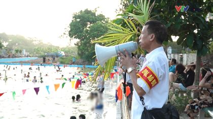
- Caption: bài báo dài về dân làng Hưng Giáo biến ao làng thành bể bơi miễn phí cho trẻ em.
- Ảnh: ảnh báo VTV, người cầm loa trông trẻ bơi.
- Vì sao: thông tin thuần, ảnh minh hoạ đúng nội dung.

**id 7871**: tin buồn
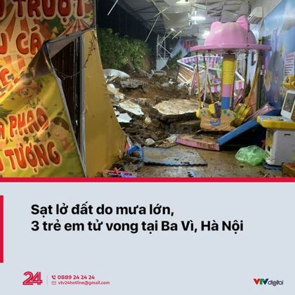
- Caption: tin sạt lở đất ở Ba Vì làm 3 trẻ tử vong.
- Ảnh: thẻ tin VTV24 "Sạt lở đất do mưa lớn, 3 trẻ em tử vong tại Ba Vì, Hà Nội".
- Vì sao: tin buồn, không có thái độ. Gần như mọi thẻ tin của VTV24 trong mẫu đều là `not-sarcasm` (id 1626, 7647, 7871).

**id 5482**: trêu đùa vẫn là không châm biếm
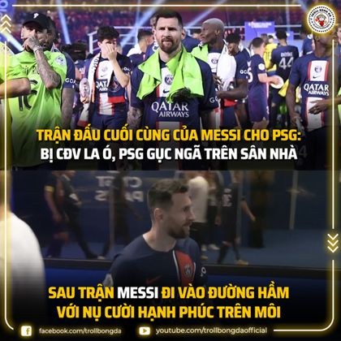
- Caption: "Mừng quá, thoát khỏi đây rồi :)))"
- Ảnh: Troll Bóng Đá, "Trận đấu cuối cùng của Messi cho PSG: bị CĐV la ó... Sau trận Messi đi vào đường hầm với nụ cười hạnh phúc trên môi".
- Vì sao: caption nói giọng Messi, đùa cợt, có `:)))`, nhưng lại được gán `not-sarcasm`. Đây là mẫu gần ranh giới: rất nhiều bài tương tự trong dữ liệu được gán `multi-sarcasm` (mục 7).

**id 9081**: tiêu đề phóng đại
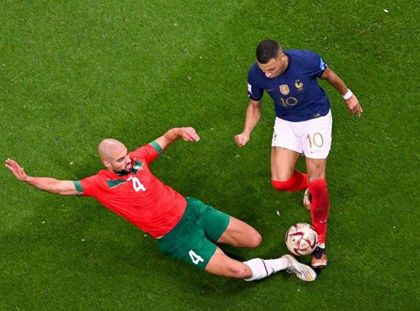
- Caption: "TIN CHUẨN: KẺ HUỶ DIỆT MBAPPE CHUẨN BỊ GIA NHẬP QUỶ ĐỎ!"
- Ảnh: Amrabat xoạc bóng Mbappe.
- Vì sao: "kẻ huỷ diệt" là phóng đại kiểu tiêu đề, không nói ngược.

**id 8262**: tiêu đề có 🤡 nhưng không châm biếm
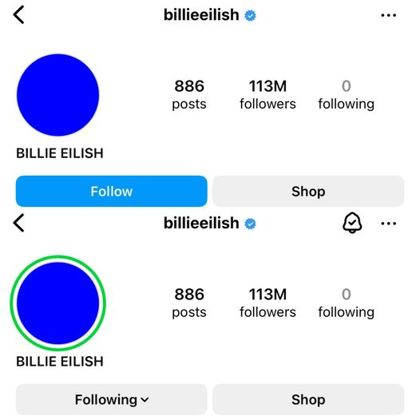
- Caption: "🤡 BILLIE EILISH ADD HẾT 113M FOLLOWERS VÀO CLOSE FRIEND..."
- Ảnh: hai ảnh chụp trang Instagram của Billie Eilish, trước và sau khi có vòng xanh "close friend".
- Vì sao: tin vui về người nổi tiếng. Emoji 🤡 không đủ để thành châm biếm.

**id 8871**: meme theo khuôn
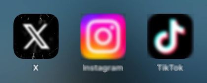
- Caption: "Tôi có 3 tính cách ở 3 nơi khác nhau:"
- Ảnh: biểu tượng X, Instagram, TikTok.
- Vì sao: tự giễu nhẹ, không chế giễu ai. Cùng kiểu với id 4097 "Cách tôi suy nghĩ / Cách tôi nói" (ảnh mèo).

**id 4334**: đùa trong cộng đồng
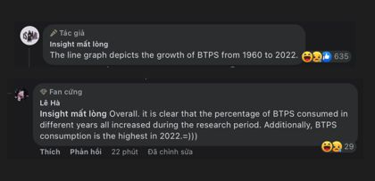
- Caption: "Còn thiếu 2 body paragraph"
- Ảnh: bình luận Facebook. Bài viết là câu mở đầu IELTS về biểu đồ, một người bình luận viết tiếp câu "Overall...".
- Vì sao: đùa kiểu dân học IELTS, không có mục tiêu chế giễu.

**id 37**: quảng cáo
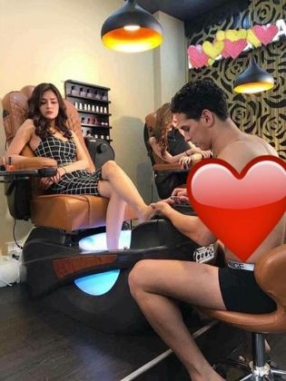
- Caption: "Chồng đi hát mà ở nhà buồn quá thì ce mình đi làm nails nhaa"
- Ảnh: tiệm nail, người mẫu nam cởi trần làm móng cho khách nữ.
- Vì sao: quảng cáo vui, không nói ngược.

**id 2255, 2256**: ảnh quảng cáo hài của Troll Xe
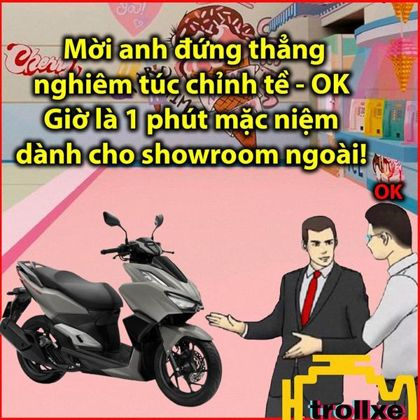 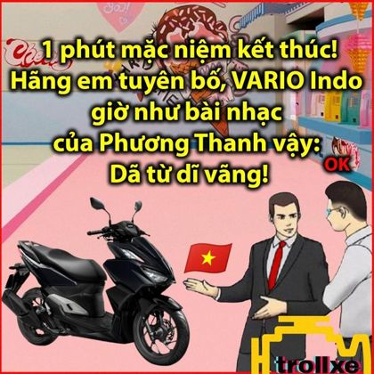
- Caption chung: "HƯỚNG DẪN CH.ỐT VARIO MỘT TRĂM SÁU CHỤC..." (bài quảng cáo dài, giọng vui).
- Ảnh: meme kiểu nhân viên bán xe ("Mời anh đứng thẳng nghiêm túc chỉnh tề... 1 phút mặc niệm dành cho showroom ngoài!").
- Vì sao: meme quảng cáo được coi là hài hước, không châm biếm. Ảnh 2259 của cùng bài ("A mua xe hãng có BẢO HÀNH, A mua xe ngoài phải tìm người... BẢO KÊ =))") lại là `image-sarcasm` vì có mục tiêu chế giễu (xe mua ngoài).

**id 1145**: meme của trang meme vẫn có thể là không châm biếm
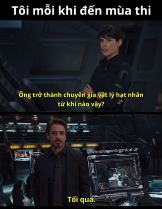
- Caption: "- Elsa #interpool #WMO #WorldMemeOrganization"
- Ảnh: meme Avengers, "Tôi mỗi khi đến mùa thi. Ông trở thành chuyên gia vật lý hạt nhân từ khi nào vậy? Tối qua."
- Vì sao: tự giễu về ôn thi cấp tốc. Cùng caption và cùng trang, các meme khác được gán `image-sarcasm` (id 1434, 1440, 1441, 1490) hoặc `multi-sarcasm` (id 1400).

**id 9828**: cùng caption, khác nhãn
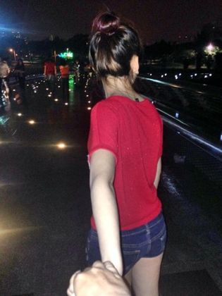
- Caption: "-= TRÀO LƯU MỚI NHẤT NĂM NAY: NẮM TAY EM ĐI KHẮP THẾ GIAN !! ❤️😍 =- **chú ý: không dành cho mấy bà FA đâu nha !! 💕🥰"
- Ảnh: ảnh kiểu "follow me", tay người nắm tay cô gái đi phía trước.
- Vì sao: giới thiệu trào lưu. Mẫu id 9830 cùng caption, ảnh cùng kiểu, lại mang nhãn `multi-sarcasm` (mục 6).

---

## 4. `text-sarcasm`: châm biếm nằm ở caption

### Định nghĩa trong thực tế

- **Caption tự nó có ý châm biếm**: nói ngược, khen để chê, chơi chữ chế giễu, ngoặc kép mỉa mai, thường kèm `:)))`, `=))`, 🙃.
- **Ảnh không tự châm biếm**: thẻ tin, ảnh chụp sự kiện, ảnh sản phẩm, ảnh chụp câu nói của người được nhắc tới. Ảnh thường là **đối tượng hoặc bối cảnh** của lời mỉa mai.
- Nhãn hiếm nhất (77 mẫu train, 1 mẫu val), và dữ liệu dùng nó không nhất quán. Cùng kiểu "caption mỉa mai + ảnh trung tính" thường được gán `multi-sarcasm` hơn (mục 7.1).

**Điểm khó:** nhiều mẫu `text-sarcasm` **cần ảnh để hiểu** ý mỉa mai (id 409, 449, 713). Như vậy trong thực tế, nhãn này **không** có nghĩa là "chỉ đọc caption cũng hiểu". Nó có nghĩa là "người nói lời mỉa mai là caption, ảnh chỉ là cái bị nói tới".

### Ví dụ

**id 4329**: caption tự đủ nghĩa
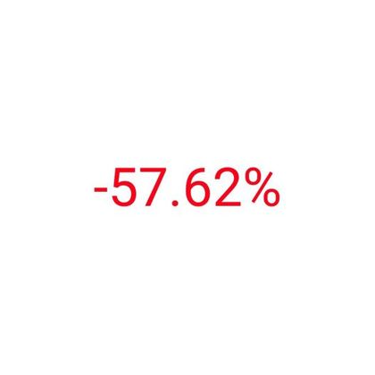
- Caption: "Thôi sếp nói gì cũng đúng, lười cãi nữa rồi"
- Ảnh: chỉ có con số "-57.62%" màu đỏ (ảnh tài khoản đầu tư lỗ).
- Vì sao: "sếp nói gì cũng đúng" là nói ngược, chê sếp. Ảnh chỉ cho biết bối cảnh.

**id 5863**: mỉa mai một nhóm khác với nội dung ảnh
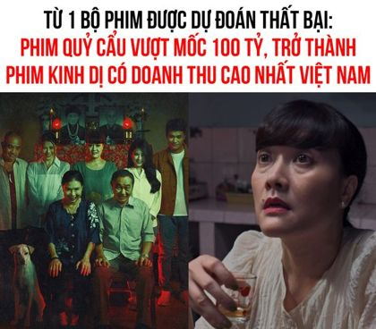
- Caption: "Còn mấy bộ dự kiến là siêu phẩm thì flop sấp mặt🙃"
- Ảnh: tin "Từ 1 bộ phim được dự đoán thất bại: phim Quỷ Cẩu vượt mốc 100 tỷ".
- Vì sao: ảnh là tin trung tính. Caption chế giễu các phim "siêu phẩm" khác, có 🙃.

**id 4033**: chơi chữ chế giễu
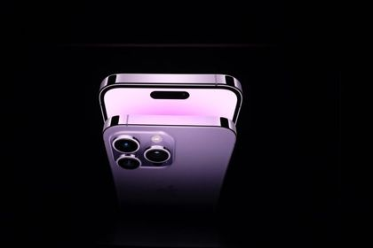
- Caption: "Iphone 14 chính thức lộ diện, người hạnh phúc nhất lúc này là các anh chồng, vì sắp được tặng con 13 của vợ rồi"
- Ảnh: ảnh sản phẩm iPhone 14.
- Vì sao: "hạnh phúc nhất" là nói ngược: chồng chỉ được nhận lại máy cũ.

**id 449**: chế giễu câu nói in trên ảnh
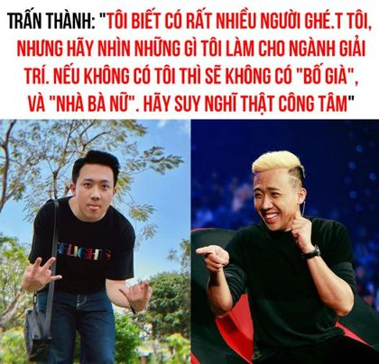
- Caption: "Không có anh, giới giải trí sẽ mất đi một người suốt ngày hay khóc"
- Ảnh: hai ảnh Trấn Thành, chữ "Tôi biết có rất nhiều người ghét tôi, nhưng hãy nhìn những gì tôi làm cho ngành giải trí...".
- Vì sao: ảnh chỉ trích lời Trấn Thành (trung tính). Caption đáp lại bằng lời mỉa mai. Hiểu caption cần ảnh, nhưng nhãn vẫn là `text`.

**id 409**: cũng cần ảnh để hiểu
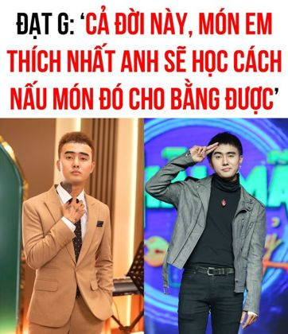
- Caption: "Chắc anh nấu cơm nắm đ.ấm cho em ăn :)))"
- Ảnh: tiêu đề "Cả đời này, món em thích nhất anh sẽ học cách nấu món đó cho bằng được" và ảnh một nam ca sĩ.
- Vì sao: caption biến câu ngọt ngào trong ảnh thành "cơm nắm đấm". Ý mỉa mai chỉ có khi ghép với ảnh, nhưng được gán `text`. Theo tiêu chí "mismatch" của hướng dẫn chính thức thì mẫu này lẽ ra là `multi`.

**id 713**: caption bình luận chi tiết trong ảnh
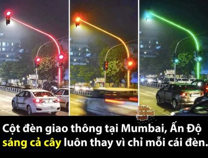
- Caption: "🚦 Và mỉa mai thay, ở bức ảnh đèn vàng thì cái xe lại phóng nhanh =))))))))"
- Ảnh: Kiến Không Ngủ, "Cột đèn giao thông tại Mumbai, Ấn Độ sáng cả cây...", 3 ảnh đèn đỏ, vàng, xanh. Ở ảnh đèn vàng có chiếc xe bị nhoè vì chạy nhanh.
- Vì sao: ảnh là tin thú vị, không chế giễu. Lời mỉa mai do caption chỉ ra.

**id 880**: caption biến tin thành chuyện đùa
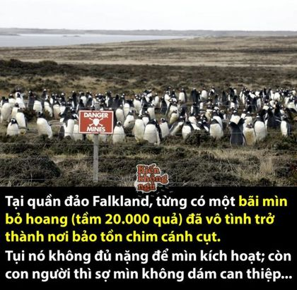
- Caption: "KHI BỊ GỠ MÌN, CƯ DÂN TRÊN ĐẢO ĐÃ PHẢN ĐỐI KỊCH LIỆT... 😡💣" và bài giải thích về chim cánh cụt ở bãi mìn Falkland.
- Ảnh: Kiến Không Ngủ, chim cánh cụt trong bãi mìn, chữ "tụi nó không đủ nặng để mìn kích hoạt; còn con người thì sợ mìn không dám can thiệp...".
- Vì sao: "cư dân phản đối kịch liệt" là cách nói đùa của caption. Ảnh cũng dí dỏm nhưng chỉ đưa thông tin.

**id 3740**: nói ngược ngắn
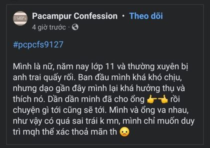
- Caption: "Nhà ngọt -kem"
- Ảnh: ảnh chụp bài confession về chuyện loạn luân, nội dung gây sốc.
- Vì sao: "nhà ngọt" là khen ngược. Nội dung ảnh gây sốc nhưng tự nó không châm biếm.

**id 9621**: chơi chữ trong quảng cáo
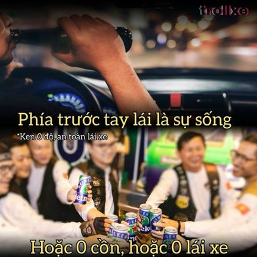
- Caption: "Nhậu là để VUI chứ ko phải để XUI #Heineken00 #Ken0Do..."
- Ảnh: quảng cáo Heineken 0 độ, "Phía trước tay lái là sự sống... Hoặc 0 cồn, hoặc 0 lái xe".
- Vì sao: chơi chữ VUI/XUI. Mẫu gần ranh giới với `not-sarcasm`, vì quảng cáo thường được gán `not`.

**Mẫu khó giải thích** (nên coi là nhiễu nhãn):
- **id 957**: caption "🍎", ảnh là truyện tranh Bạch Tuyết làm bánh táo, cuối truyện 7 chú lùn chết. Ý châm biếm (hài đen) nằm hết trong ảnh, đáng lẽ là `image-sarcasm`.
- **id 4948**: caption là bài viết nghiêm túc "Mục tiêu của giáo dục không nên là điểm số", ảnh hội thảo. Không thấy ý châm biếm.
- **id 5102–5105**: 4 ảnh truyện tranh khác nhau của cùng bài "Mot cai ket co hau", đều là `text-sarcasm` dù ý chính nằm trong tranh.

---

## 5. `image-sarcasm`: châm biếm nằm ở ảnh

### Định nghĩa trong thực tế

- **Ảnh là một trò đùa trọn vẹn**: meme có chữ, truyện tranh, ảnh chụp tin nhắn hay bình luận có câu chốt, ảnh ghép so sánh "ở trong phim / những gì tôi thấy".
- **Caption không thêm ý châm biếm riêng.** Thường gặp:
  - chỉ có emoji: "🥶🥶", "😭", "🙂", "👀"
  - mở đầu cho ảnh: "Tôi:", "Những gì làm tôi mê đắm những ngày qua:"
  - phản ứng ngắn: "Ủa", "Có gì đó không đúng"
  - lời thoại hoặc trích dẫn của nhân vật trong ảnh
  - tên series, chữ ký trang, hashtag
  - đưa thông tin, giải thích, hoặc khen ngợi chân thành
- **Caption hơi mỉa mai đôi khi vẫn được tính là `image`** nếu câu chốt chính nằm trong ảnh (id 275, 7180). Đây là ranh giới yếu nhất với `multi` (mục 7.2).

### Ví dụ

**id 757**: emoji
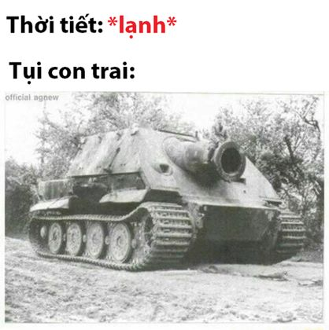
- Caption: "🥶🥶"
- Ảnh: "Thời tiết: *lạnh*. Tụi con trai:" kèm ảnh xe tăng (ý: con trai mặc như xe tăng, hoặc "lạnh lùng" như xe tăng).

**id 4117**: emoji, câu chốt trong tin nhắn
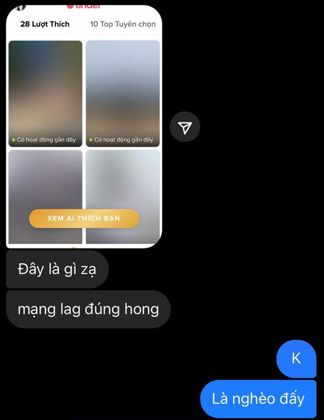
- Caption: "😭"
- Ảnh: chụp tin nhắn. "Đây là gì zạ, mạng lag đúng hong" (ảnh "Xem ai thích bạn" bị làm mờ), trả lời "K, là nghèo đấy" (vì không trả tiền xem).

**id 3984**: "Tôi:"
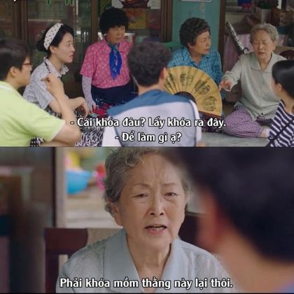
- Caption: "Tôi:"
- Ảnh: cảnh phim Hàn, "Cái khoá đâu? Lấy khoá ra đây. Để làm gì ạ? Phải khoá mồm thằng này lại thôi."

**id 3056**: phản ứng một từ
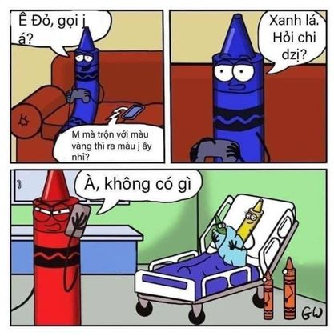
- Caption: "Ủa"
- Ảnh: truyện tranh bút sáp. Bút đỏ hỏi bút xanh "trộn với màu vàng thì ra màu gì?", bút xanh đáp "Xanh lá. Hỏi chi dzị?", khung cuối bút đỏ nói "À, không có gì" bên giường bệnh của bút vàng: hài đen.

**id 758**: emoji, câu chốt trong tweet
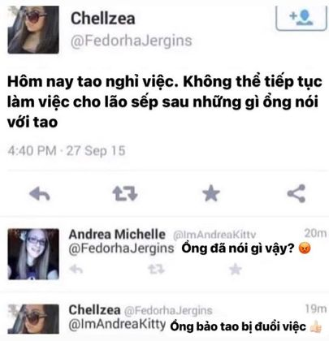
- Caption: "🙂"
- Ảnh: tweet "Hôm nay tao nghỉ việc. Không thể tiếp tục làm cho lão sếp sau những gì ổng nói", hỏi "Ổng đã nói gì vậy?", đáp "Ổng bảo tao bị đuổi việc 👍".

**id 3343**: chữ ký trang
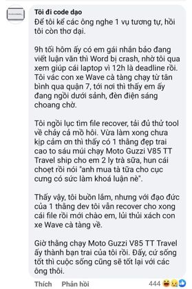
- Caption: "👀 -kem"
- Ảnh: bình luận kể chuyện cứu file luận văn cho em gái, rồi em gái thành bạn gái của anh chàng đi Moto Guzzi: câu chốt "cứ sống tốt thì cuộc sống cũng sẽ tốt lại với các ông thôi" là nói ngược.

**id 9890**: mở đầu cho ảnh
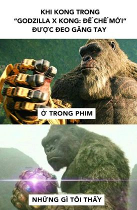
- Caption: "Những gì làm tôi mê đắm những ngày qua:"
- Ảnh: "Khi Kong trong Godzilla x Kong được đeo găng tay. Ở trong phim / Những gì tôi thấy" (găng vô cực của Thanos).

**id 275**: caption có chơi chữ nhẹ vẫn là `image`
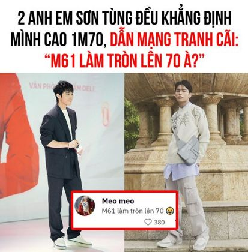
- Caption: "Tuy không cao nhưng cũng khiến người khác phải ngước nhìn"
- Ảnh: tin "2 anh em Sơn Tùng đều khẳng định mình cao 1m70, dân mạng tranh cãi: M61 làm tròn lên 70 à?", kèm bình luận "Meo meo: M61 làm tròn lên 70 😂".
- Vì sao: câu chế giễu chính nằm trong ảnh. Caption chơi chữ "ngước nhìn" có thể hiểu là mỉa mai nhẹ, nhưng không được tính.

**id 7180**: caption nói giảm
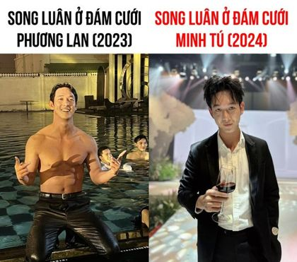
- Caption: "Song Luân mới có bạn gái được 1 năm mà nhiều người nhận xét khác đi trông thấy"
- Ảnh: "Song Luân ở đám cưới Phương Lan (2023)" cởi trần dưới hồ bơi, "ở đám cưới Minh Tú (2024)" mặc vest chỉnh tề.
- Vì sao: sự đối lập trong ảnh là câu chốt.

**id 1054**: caption đính chính, khen thật lòng
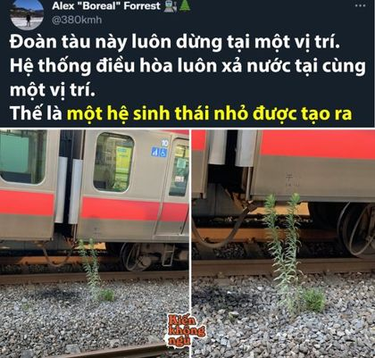
- Caption: "ỎOOOO 🥺 Thật ra cái này gọi là Vi Khí Hậu chứ hông phải hệ sinh thái, nhưng mà nhìn cute quá nên bỏ qua lỗi sai đi ❤"
- Ảnh: Kiến Không Ngủ, "Đoàn tàu này luôn dừng tại một vị trí. Hệ thống điều hoà luôn xả nước... Thế là một hệ sinh thái nhỏ được tạo ra" (cây mọc dưới gầm tàu).
- Vì sao: caption không châm biếm. Ảnh cũng khó coi là châm biếm; đây là mẫu sát ranh giới với `not-sarcasm`.

**id 2259**: một ảnh châm biếm trong bài nhiều ảnh
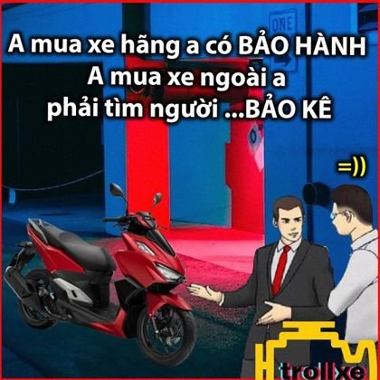
- Caption: bài quảng cáo Vario như id 2255.
- Ảnh: "A mua xe hãng a có BẢO HÀNH, A mua xe ngoài a phải tìm người... BẢO KÊ =))".
- Vì sao: ảnh này có mục tiêu chế giễu (xe mua ngoài), 4 ảnh còn lại của bài thì không.

**id 3022**: ví dụ của hướng dẫn chính thức, nhãn khớp
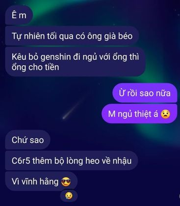
- Caption: "Có gì đó không đúng -kem"
- Ảnh: tin nhắn, ông già trả tiền để bỏ Genshin đi ngủ, "C6R5 thêm bộ lòng heo về nhậu".
- So sánh với id 8062 (`multi`, mục 6): caption gần như giống hệt, nhãn khác.

**Mẫu khó giải thích:**
- **id 5795**: thẻ tin VTV24 "Chùa Ba Vàng gỡ bỏ các thông tin về Xá lợi tóc Đức Phật", caption là bài báo. Mọi thẻ tin VTV24 khác trong mẫu là `not-sarcasm`. Có thể người gán thấy bản thân sự việc trớ trêu.
- **id 215**: ảnh biệt thự trong bài "Bán đồng hồ fake giàu quá mà 😏", 4 ảnh còn lại của bài (id 211–214) là `multi-sarcasm` (mục 6).

---

## 6. `multi-sarcasm`: châm biếm cần cả caption và ảnh

### Định nghĩa trong thực tế

Có hai kiểu chính, chiếm phần lớn nhãn này:

**Kiểu A: ảnh là trò đùa, caption đùa tiếp.** Ảnh tự có câu chốt, và caption thêm một tầng nghĩa của riêng nó: đóng vai nhân vật, chơi chữ, khen ngược, kết luận mỉa mai.

**Kiểu B: caption mỉa mai về một ảnh trung tính.** Ảnh là ảnh thật hoặc ảnh tin, và caption nói ngược hoặc bịa chuyện về nó. Ý châm biếm nằm ở chỗ **lệch giữa lời caption và cái ảnh cho thấy**. Kiểu này trùng với định nghĩa `text-sarcasm` ở mục 4, và dữ liệu gán `multi` thường xuyên hơn.

Ngoài ra còn kiểu caption ngắn hoặc chỉ là tên series trên một ảnh meme. Kiểu này lẽ ra là `image-sarcasm` theo mục 5, nhưng thường được gán `multi` (mục 7.2).

### Ví dụ kiểu A: ảnh đùa, caption đùa tiếp

**id 9459**
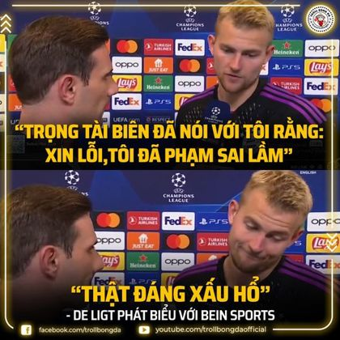
- Caption: "Thôi để 31/6 rồi đá lại =))"
- Ảnh: Troll Bóng Đá, De Ligt: "Trọng tài biên đã nói với tôi rằng: xin lỗi, tôi đã phạm sai lầm", "Thật đáng xấu hổ".
- Vì sao: ảnh chế giễu trọng tài, caption hứa đá lại vào ngày 31/6 (ngày không tồn tại).

**id 317**
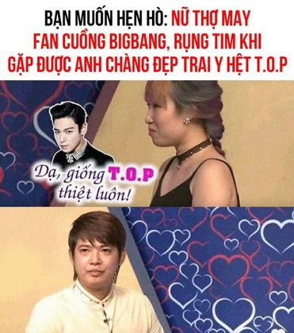
- Caption: "Là giống dữ chưaa"
- Ảnh: tin hẹn hò "Nữ thợ may fan cuồng BigBang rụng tim khi gặp anh chàng đẹp trai y hệt T.O.P", ảnh anh chàng không giống chút nào, chữ "Dạ, giống T.O.P thiệt luôn!".
- Vì sao: ảnh đã mỉa mai, caption khen ngược thêm.

**id 9630**
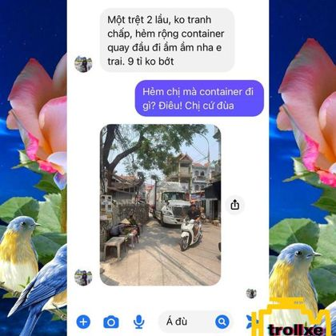
- Caption: "Chị Nga nói có sách mách có chứng!"
- Ảnh: Troll Xe, tin nhắn bán nhà "hẻm rộng container quay đầu đi ầm ầm", "Hẻm chị mà container đi gì? Điêu!", rồi ảnh container đi trong hẻm thật.
- Vì sao: caption khen người bán nhà "có sách mách có chứng", tiếp nối câu chốt của ảnh.

**id 9666**: caption ngắn nhưng vẫn là `multi`
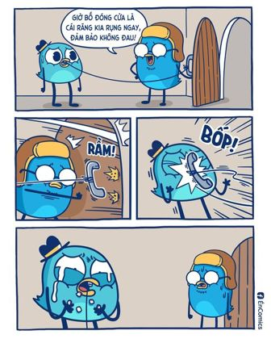
- Caption: "niềm tin đã mất #Éncomics #Én"
- Ảnh: truyện tranh "Giờ bố đóng cửa là cái răng kia rụng ngay, đảm bảo không đau!", cửa đóng, điện thoại văng vào mặt.
- Vì sao: caption chỉ là lời phản ứng ngắn. So với id 3056 "Ủa" (`image`), không có khác biệt rõ ràng.

**id 2645**: caption hai nghĩa
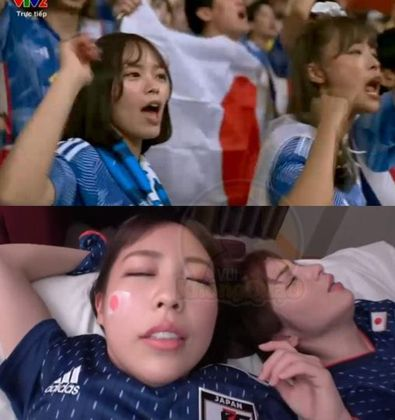
- Caption: "Cổ vũ mệt thật"
- Ảnh: cổ động viên nữ Nhật hò hét, rồi ảnh hai cô nằm trên giường với vẻ mặt gợi ý nghĩa khác.
- Vì sao: caption ngây thơ ghép với ảnh tạo nghĩa ẩn.

**id 2306**: caption chế giễu tin đồn, ảnh là bằng chứng
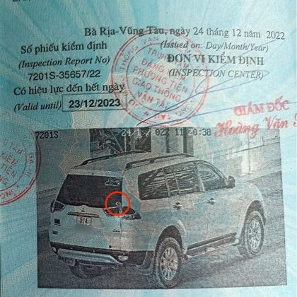
- Caption: "- Khứa nào đồn dán lên rớt đâu??? P/S: Con giời Châu Minh Trí..."
- Ảnh: giấy kiểm định xe, khoanh đỏ chỗ dán tem Troll Xe trên kính sau.
- Vì sao: ảnh chứng minh tem không rớt, caption mỉa người tung tin đồn.

### Ví dụ kiểu B: caption mỉa mai về ảnh trung tính

**id 8562**
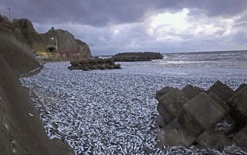
- Caption: "THẢ CÁ ÔNG CÔNG ÔNG TÁO TẠI XỨ SỞ HOA ANH ĐÀO 😍 Một bức ảnh quá nhiều cảm xúc... Có quyền mong... cho một ngày thả cá ở Việt Nam?"
- Ảnh: hàng nghìn con cá chết dạt vào bờ biển (Nhật).
- Vì sao: caption gọi thảm hoạ cá chết là "thả cá ông Công ông Táo", kèm 😍. Ảnh trung tính, lời mỉa mai nằm ở caption, nhưng nhãn là `multi`. So với id 4329 (`text`).

**id 10373**
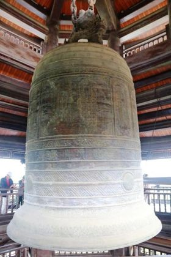
- Caption: "CHIẾC CHUÔNG KHỔNG LỒ NẰM GIỮA LONDON... ngôi chùa mang tên Át Nan Tự... khắc 2 chữ PHẤN - ĐÀO nhằm nhắc nhở hậu thế về đội bóng 20 năm đ vô địch nổi EPL."
- Ảnh: chiếc chuông đồng trong chùa (ảnh thật, trung tính).
- Vì sao: caption bịa chuyện để chế giễu Arsenal ("Át Nan", "Phấn Đào"), ảnh chỉ là đạo cụ.

**id 8632**
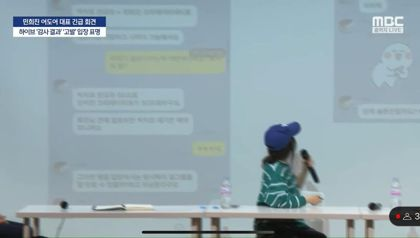
- Caption: "🚨 MIN HEE JIN PUBLIC TIN NHẮN RIÊNG VỚI CHỦ TỊCH BANG SI HYUK GỬI: 'EM DẪN LÊN AESPA ĐƯỢC KHÔNG?'"
- Ảnh: bản tin MBC, bà Min Hee Jin họp báo, màn hình chiếu tin nhắn.
- Vì sao: câu trích trong caption là bịa (chơi chữ từ "dẫn lên"). Ảnh tin trung tính.

**id 211** (cùng bài với id 212–215)

- Caption: "Bán đồng hồ fake giàu quá mà 😏"
- Ảnh: ảnh gia đình ở hồ bơi resort, các ảnh khác là biệt thự.
- Vì sao: caption mỉa mai nguồn tiền của chủ biệt thự, ảnh chỉ khoe nhà. 4 ảnh mang nhãn `multi`, 1 ảnh (id 215) mang nhãn `image`, dù cả 5 ảnh đều là ảnh nhà bình thường.

### Ví dụ caption ngắn hoặc trung tính trên meme

**id 8062**: gần giống ví dụ chính thức của `image`
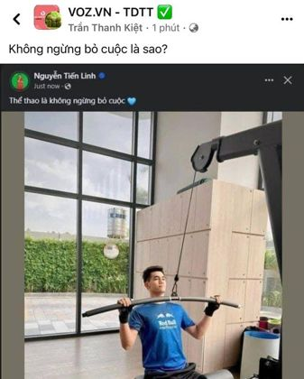
- Caption: "Hình như có gì đó sai sai"
- Ảnh: VOZ, Nguyễn Tiến Linh đăng "Thể thao là không ngừng bỏ cuộc" (viết nhầm), bình luận "Không ngừng bỏ cuộc là sao?".
- Vì sao: theo hướng dẫn chính thức (ví dụ id 3022, "Có gì đó không đúng") thì là `image`. Ở đây lại là `multi`.

**id 806**: chỉ có emoji
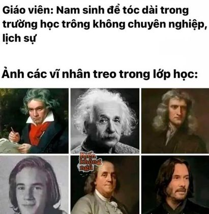
- Caption: "🧏🏻‍♀️🧏🏻‍♀️🧏🏻‍♀️"
- Ảnh: "Giáo viên: Nam sinh để tóc dài trong trường học trông không chuyên nghiệp lịch sự. Ảnh các vĩ nhân treo trong lớp học:" (Beethoven, Einstein, Newton... đều tóc dài).
- Vì sao: cùng kiểu với id 757, 4117, 758 (`image`). Emoji 🧏 ("nghe chưa") có thể được coi là thêm thái độ.

**id 2482**: tên series
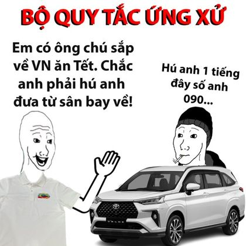
- Caption: "- Thầy Cụt cùng với ban chấp hành TROLL XE... hoàn thiện bộ quy tắc ứng xử... (Phần 6) #QuyTacUngXuTX"
- Ảnh: meme "Bộ quy tắc ứng xử", "Em có ông chú sắp về VN ăn Tết. Chắc anh phải hú anh đưa từ sân bay về!", "Hú anh 1 tiếng đây số anh 090...".
- Vì sao: caption chỉ là tên series. Cả 55 mẫu `#quytacungxutx` trong train đều là `multi`: trang này được gán theo một kiểu cố định.

**id 9830**: cùng caption với id 9828 (`not`)
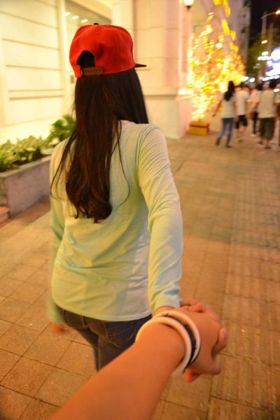
- Caption: giống hệt id 9828 ("TRÀO LƯU MỚI NHẤT NĂM NAY: NẮM TAY EM ĐI KHẮP THẾ GIAN").
- Ảnh: cô gái đội mũ đỏ kéo tay người chụp đi trên phố.
- Vì sao: không thấy khác biệt nào giữa hai ảnh đủ để đổi nhãn.

---

## 7. Ranh giới không nhất quán

### 7.1. `text-sarcasm` hay `multi-sarcasm`: caption mỉa mai, ảnh trung tính

| Gán `text` | Gán `multi` |
|---|---|
| id 4329 "sếp nói gì cũng đúng", ảnh "-57.62%" | id 8562 "thả cá ông Công ông Táo", ảnh cá chết |
| id 4033 "anh chồng hạnh phúc nhất", ảnh iPhone | id 211 "bán đồng hồ fake giàu quá mà 😏", ảnh biệt thự |
| id 449 câu mỉa mai đáp lại câu nói trong ảnh | id 8632 câu trích bịa về ảnh tin MBC |
| id 713 caption chỉ ra chi tiết trong ảnh | id 10373 chuyện bịa về ảnh chiếc chuông |

Không tìm ra quy tắc tách hai cột. Gợi ý gần đúng nhất: caption **bịa chuyện, đóng vai, hoặc nói ngược về chính cái ảnh cho thấy** thì hay là `multi`. Caption **bình luận về một chủ đề**, ảnh chỉ là bối cảnh, thì hay là `text`. Mẫu id 713 và 449 đi ngược gợi ý này.

Theo tần suất (77 so với 4 224), khi phân vân giữa hai nhãn này thì `multi` đúng thường hơn.

### 7.2. `image-sarcasm` hay `multi-sarcasm`: ảnh là meme, caption ngắn

| Gán `image` | Gán `multi` |
|---|---|
| id 3022 "Có gì đó không đúng" | id 8062 "Hình như có gì đó sai sai" |
| id 3056 "Ủa", truyện tranh | id 9666 "niềm tin đã mất", truyện tranh |
| id 757 "🥶🥶", id 758 "🙂" | id 806 "🧏🏻‍♀️🧏🏻‍♀️🧏🏻‍♀️" |
| meme trang Interpool (id 1434, 1440, 1441) | meme trang Interpool (id 1400) |

Gợi ý gần đúng: caption **chỉ là phản ứng** (emoji, "Ủa", "Tôi:") thì hay là `image` (28% mẫu `image` có caption ≤ 3 từ, so với 15% ở `multi`). Caption **có một ý của riêng nó** (khen ngược, kết luận, đóng vai) thì hay là `multi`. Có nhiều ngoại lệ như bảng trên.

### 7.3. `not-sarcasm` hay một nhãn châm biếm: hài hước, quảng cáo

| Gán `not` | Gán châm biếm |
|---|---|
| id 5482 caption đùa giọng Messi, `:)))` | id 9459 caption đùa về trận đấu, `=))` (`multi`) |
| id 2255, 2256 meme quảng cáo Troll Xe | id 2259 meme quảng cáo Troll Xe (`image`) |
| id 1145 meme Interpool tự giễu | id 1434 meme Interpool (`image`) |
| id 9828 "trào lưu nắm tay em" | id 9830 cùng caption (`multi`) |

Gợi ý gần đúng: có **mục tiêu bị chế giễu** (một người, một nhóm, một sản phẩm khác, một sự việc) thì là châm biếm. Chỉ vui, tự giễu, hoặc quảng cáo thì là `not`.

### 7.4. Nhãn mâu thuẫn với hướng dẫn chính thức

Xem `docs/annotation_guideline.md` mục 7: 3/5 ví dụ chính thức có trong dữ liệu mang nhãn khác (id 8517, 493, và một mẫu private test).

---

## 8. Quy trình quyết định đề xuất

Quy trình này mô tả cách gán **khớp với dữ liệu nhiều nhất** theo những gì đã đọc, không phải cách "đúng" về lý thuyết.

```
Bước 1. Bỏ qua chữ ký và thẻ trang nguồn (-kem, - Elsa, #interpool, trollxe...).

Bước 2. Có mục tiêu bị chế giễu không (người, nhóm, sản phẩm, sự việc), hoặc có nói ngược ý không?
        - Không: tin tức, quảng cáo, khoe, kể chuyện, hài tự giễu  -> not-sarcasm
        - Có: sang bước 3

Bước 3. Câu chốt châm biếm nằm ở đâu?
        a. Trong ảnh (meme, truyện tranh, tin nhắn có câu chốt), và caption
           chỉ là emoji, "Tôi:", "Ủa", lời thoại, tên series, thông tin    -> image-sarcasm
        b. Trong ảnh, và caption thêm một ý mỉa mai của riêng nó
           (khen ngược, đùa tiếp, đóng vai, kết luận)                  -> multi-sarcasm
        c. Trong caption, ảnh trung tính:
           - caption bịa chuyện, đóng vai, nói ngược về cái ảnh cho thấy -> multi-sarcasm
           - caption tự đủ nghĩa, ảnh chỉ là bối cảnh                   -> text-sarcasm
           - phân vân                                                   -> multi-sarcasm (phổ biến hơn 55 lần)
```

Bài đăng nhiều ảnh: áp dụng cho **từng ảnh** với cùng caption. Một ảnh có câu chốt riêng có thể là `image-sarcasm` trong khi các ảnh khác của bài là `not-sarcasm`.

---

## 9. Hệ quả cho dự án

1. **Giới hạn trên của mọi model.** Ranh giới `text`/`multi` và `image`/`multi` không nhất quán trong chính dữ liệu, nên không model nào đạt F1 cao ở `text-sarcasm` và `image-sarcasm`. Điều này giải thích F1 `image-sarcasm` chỉ 0,03–0,13 ở mọi baseline và mọi teacher.
2. **Bài nhiều ảnh dùng chung caption.** Model chỉ đọc caption không thể đúng hết các bài này. Đây là lý do thêm để dùng ảnh. Kết quả D1 (đổi ảnh làm 14–28% dự đoán đổi) cho thấy model có dùng ảnh.
3. **Trang nguồn quyết định một phần nhãn.** Ví dụ `#quytacungxutx` luôn là `multi`, thẻ tin VTV24 gần như luôn là `not`. Kết quả kiểm tra thẻ nguồn (bỏ thẻ mất khoảng 2 điểm macro-F1) phản ánh điều này.
4. **Prompt cho teacher.** Có thể dùng quy trình mục 8 và các ví dụ ở đây thay cho quy tắc của v7, v8. Các ví dụ là mẫu train: nếu đưa vào prompt phải loại khỏi bước sinh reasoning (như `DATASET_EXAMPLE_IDS`).
5. **Báo cáo.** Mục 7 là bằng chứng định tính cho hạn chế về chất lượng nhãn, nên trích kèm bảng đối chiếu của `docs/annotation_guideline.md` mục 7.
