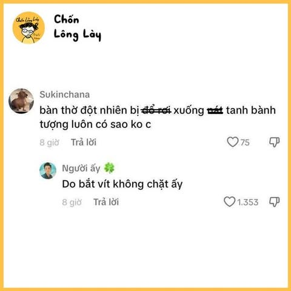
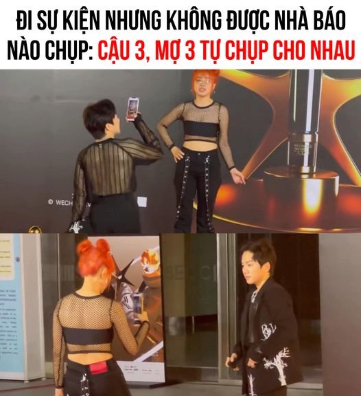
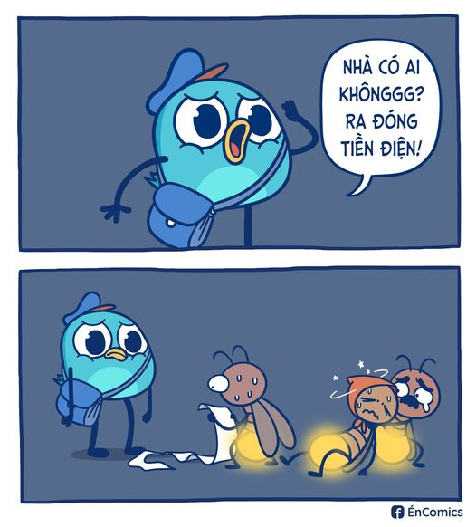
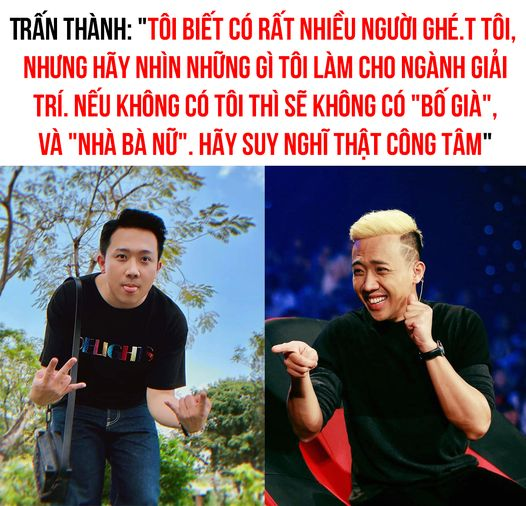
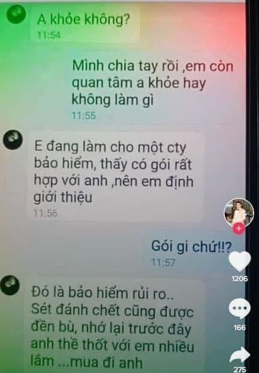
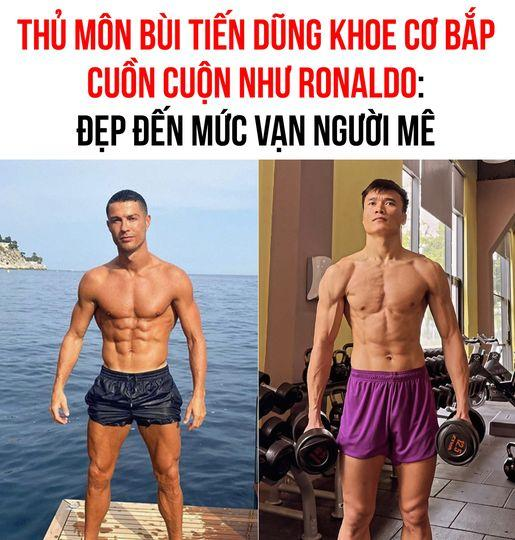
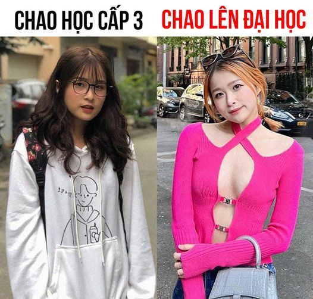

# Phân tích một số cách gán nhãn của bộ dữ liệu (Phân tích trường hợp nào thì vào nhãn gì)

## 1. Tổng quan về labeling scheme

Bộ dữ liệu ViMMSD sử dụng 4 nhãn dựa trên sự xuất hiện của yếu tố mỉa mai ở từng modality (text/image):

| Nhãn | Tên | Định nghĩa ngắn gọn |
|---|---|---|
| 0 | Non-sarcasm | Không mỉa mai ở cả text và image |
| 1 | Multi-sarcasm | Mỉa mai ở cả text và image, hoặc sự kết hợp text+image tạo mỉa mai |
| 2 | Text-sarcasm | Mỉa mai chỉ ở text |
| 3 | Image-sarcasm | Mỉa mai chỉ ở image |

Nguyên tắc gán nhãn cốt lõi:

- Xét từng modality riêng lẻ (text có mỉa mai không? image có mỉa mai không?
- Xét sự tương tác giữa hai modality (text+image kết hợp có tạo mỉa mai không?)
- Nếu cả hai đều **có hoặc kết hợp** tạo ra → **Multi-sarcasm**
- Nếu chỉ **một modality** có → **Text-sarcasm hoặc Image-sarcasm**
- Nếu không có → Non-sarcasm

## 2. Phân tích chi tiết từng trường hợp gán nhãn

### 2.1. Non-sarcasm (Nhãn 0)

**Định nghĩa:** Không có yếu tố mỉa mai ở cả text và image. Text và image mô tả cùng một sự việc theo cách trung tính, khớp nhau, không có mâu thuẫn hay châm biếm.

Điều kiện gán nhãn:

- Text: Không chứa irony, hyperbole, hay mismatch
- Image: Không chứa yếu tố châm biếm (biểu cảm, tình huống trớ trêu, chữ trong ảnh)
- Text và image: Khớp nhau về mặt ngữ nghĩa và cảm xúc

**Các trường hợp cụ thể:**

| STT | Trường hợp | Ví dụ | Lý do |
|---|---|---|---|
| 1 | Text mô tả đúng image | Caption: "Hôm nay trời đẹp quá" + Ảnh: bầu trời xanh, nắng | Text và image khớp, không có mỉa mai |
| 2 | Text trung tính + Image trung tính | Caption: "Đi ăn trưa thôi" + Ảnh: bàn ăn | Cả hai đều trung tính |
| 3 | Text cảm xúc thật + Image minh họa | Caption: "Vui quá, được đi chơi rồi!" + Ảnh: công viên | Cảm xúc tích cực thật, không mỉa mai |
| 4 | Text thông báo + Image minh họa | Caption: "Sản phẩm mới ra mắt" + Ảnh: sản phẩm | Thông tin trung tính |
| 5 | Text hỏi + Image trả lời | Caption: "Đây là gì?" + Ảnh: vật thể rõ ràng | Không có mỉa mai |

**Lưu ý:** *Non-sarcasm không có nghĩa là text/image phải nhàm chán. Chúng có thể vui, buồn, cảm xúc mạnh — miễn là không có sự mỉa mai.*

**Ví dụ minh họa chi tiết:**

Caption: "Người tâm linh giao tiếp với người thực tế :)))"

Image:



→ Non-sarcasm (cả text và image đều thể hiện tình cảm thật, khớp nhau)

### 2.2. Text-sarcasm (Nhãn 2)

**Định nghĩa:** Mỉa mai chỉ nằm ở phần text (caption hoặc OCR text). Image chỉ minh họa hoặc không đóng góp vào việc tạo ra mỉa mai.

*Điều kiện gán nhãn:*

- Text: Có chứa yếu tố mỉa mai (irony, hyperbole, châm biếm)
- Image: Không chứa yếu tố mỉa mai (trung tính, chỉ minh họa)
- Sự kết hợp text+image: Không tạo thêm tầng nghĩa mỉa mai mới

Các dạng Text-sarcasm:

**Dạng 1: Irony (Nói ngược ý định thực)**

| **STT** | **Trường hợp** | **Ví dụ** | **Phân tích** |
|---|---|---|---|
| 1 | Khen ngợi giả tạo | Caption: "Ồ, bài kiểm tra này dễ quá ha, chỉ có 2 điểm thôi mà" + Ảnh: tờ giấy trắng | Text nói "dễ" nhưng thực tế "2 điểm" → irony |
| 2 | Chê bai giả tạo | Caption: "Xấu quá cơ, chẳng ai thèm đâu" (kèm ảnh đẹp) | Nói ngược với sự thật |
| 3 | Cảm ơn mỉa mai | Caption: "Cảm ơn bạn đã 'giúp' tôi nhé, mất cả buổi chiều" + Ảnh: trung tính | "Giúp" trong ngoặc kép → mỉa mai |
| 4 | Khen thời tiết xấu | Caption: "Thời tiết đẹp thật đấy, mưa cả tuần" + Ảnh: trung tính | Nói ngược với thực tế |

**Dạng 2: Hyperbole (Cường điệu)**

| **STT** | **Trường hợp** | **Ví dụ** | **Phân tích** |
|---|---|---|---|
| 1 | Phóng đại quá mức | Caption: "Bài tập về nhà ít quá, chỉ có 100 trang thôi" + Ảnh: trung tính | "Ít" >< "100 trang" |
| 2 | Giảm nhẹ quá mức | Caption: "Tôi chỉ hơi đói thôi, ăn được cả con voi" + Ảnh: trung tính | Cường điệu |
| 3 | Phóng đại cảm xúc | Caption: "Tôi chết mất thôi, buồn cười quá" + Ảnh: trung tính | Cường điệu |

**Dạng 3: Châm biếm xã hội**

| **STT** | **Trường hợp** | **Ví dụ** | **Phân tích** |
|---|---|---|---|
| 1 | Châm biếm thói đời | Caption: "Đúng là người tốt, cho vay rồi mất luôn bạn" + Ảnh: trung tính | Châm biếm |
| 2 | Châm biếm chính trị | Caption: "Lãnh đạo tài ba quá, dân đói meo" + Ảnh: trung tính | Châm biếm |
| 3 | Châm biếm công việc | Caption: "Sếp tâm lý quá, bắt OT cả tuần" + Ảnh: trung tính | Châm biếm |

Lưu ý quan trọng:

- Image trong Text-sarcasm có thể liên quan đến text nhưng không góp phần tạo ra mỉa mai.
- Image có thể là ảnh minh họa trung tính, ảnh selfie, ảnh phong cảnh, v.v.
- Nếu image cũng có yếu tố mỉa mai (dù nhẹ) → chuyển thành Multi-sarcasm.

**Ví dụ minh họa chi tiết:**

Caption: "Mấy Tiktoker review đồ ăn giờ ng.áo quyền lực ghê cơ"

Image:


→ Text-sarcasm (text mỉa mai về mức tăng lương, image chỉ minh họa)

### 2.3. Image-sarcasm (Nhãn 3)

**Định nghĩa**: Mỉa mai chỉ nằm ở phần image. Caption trung tính hoặc không đóng góp vào việc tạo ra mỉa mai.

Điều kiện gán nhãn:

- Text: Không chứa yếu tố mỉa mai (trung tính)
- Image: Có chứa yếu tố mỉa mai (chữ trong ảnh, biểu cảm, tình huống trớ trêu)
- Sự kết hợp text+image: Không tạo thêm tầng nghĩa mỉa mai mới

Các dạng Image-sarcasm:

**Dạng 1: Chữ trong ảnh (Meme, Quote)**

| **STT** | **Trường hợp** | **Ví dụ** | **Phân tích** |
|---|---|---|---|
| 1 | Meme châm biếm | Caption: "Chúc mừng sinh nhật!" + Ảnh: meme "Chúc mừng sinh nhật, chúc mày cô đơn thêm một tuổi" | Chữ trong ảnh mỉa mai |
| 2 | Quote châm biếm | Caption: "Đọc sách thôi" + Ảnh: quote "Sách là bạn, nhưng bạn thì không có sách" | Chữ trong ảnh mỉa mai |
| 3 | Ảnh chế | Caption: "Xem tin tức" + Ảnh: ảnh chế chính trị | Chữ trong ảnh châm biếm |

**Dạng 2: Biểu cảm khuôn mặt**

| STT | Trường hợp | Ví dụ | Phân tích |
|---|---|---|---|
| 1 | Mặt khó chịu + text khen | Caption: "Vui quá!" + Ảnh: mặt mếu | Biểu cảm mâu thuẫn |
| 2 | Mặt cười + text chê | Caption: "Chán quá" + Ảnh: mặt cười toe toét | Biểu cảm mâu thuẫn |
| 3 | Mặt ngạc nhiên + text bình thường | Caption: "À, ra vậy" + Ảnh: mặt sốc | Biểu cảm mỉa mai |

**Dạng 3: Tình huống trớ trêu**

| STT | Trường hợp | Ví dụ | Phân tích |
|---|---|---|---|
| 1 | Tình huống ngược đời | Caption: "Đang đi nghỉ mát" + Ảnh: người ngồi làm việc | Tình huống trớ trêu |
| 2 | Thất bại rõ ràng | Caption: "Tôi là đầu bếp tài ba" + Ảnh: món ăn cháy khét | Tình huống trớ trêu |
| 3 | Mâu thuẫn thị giác | Caption: "Đang tập thể dục" + Ảnh: người nằm ngủ | Mâu thuẫn |

**Lưu ý quan trọng:**

- Image-sarcasm khó phát hiện hơn Text-sarcasm vì cần hiểu ngữ cảnh hình ảnh, văn hóa, và đôi khi cần OCR để đọc chữ trong ảnh.
- Image có thể chứa text tiếng Việt (meme, quote) → cần OCR để trích xuất.
- Nếu caption cũng có yếu tố mỉa mai (dù nhẹ) → chuyển thành Multi-sarcasm.

***Ví dụ minh họa chi tiết:***

Caption: "Tìm chỗ bán đồ giống cậu mợ"

Image:



→ Image-sarcasm (text trung tính, chữ trong ảnh mỉa mai)

### 2.4. Multi-sarcasm (Nhãn 1)

Định nghĩa: Mỉa mai ở cả text và image, hoặc sự kết hợp text+image tạo ra mỉa mai.

Điều kiện gán nhãn:

- Text: Có chứa yếu tố mỉa mai
- Image: Có chứa yếu tố mỉa mai
- HOẶC Text+Image kết hợp tạo ra mỉa mai (mismatch, contradiction)

Các dạng Multi-sarcasm:

**Dạng 1: Cả text và image đều mỉa mai riêng lẻ**

| STT | Trường hợp | Ví dụ | Phân tích |
|---|---|---|---|
| 1 | Text irony + Image meme | Caption: "Tuyệt vời! Lại thêm một ngày mưa nữa" + Ảnh: meme "Mưa là bạn" | Cả hai đều mỉa mai |
| 2 | Text hyperbole + Image biểu cảm | Caption: "Tôi chết mất thôi, vui quá" + Ảnh: mặt chán nản | Cả hai đều mỉa mai |
| 3 | Text châm biếm + Image chế | Caption: "Sếp tâm lý quá" + Ảnh: meme "Sếp là nhất" | Cả hai đều mỉa mai |

**Dạng 2: Text+Image kết hợp tạo mỉa mai (Mismatch)**

| STT | Trường hợp | Ví dụ | Phân tích |
|---|---|---|---|
| 1 | Text tích cực + Image tiêu cực | Caption: "May mắn quá!" + Ảnh: người ướt sũng | Mâu thuẫn cảm xúc |
| 2 | Text tiêu cực + Image tích cực | Caption: "Chán quá" + Ảnh: tiệc tùng | Mâu thuẫn cảm xúc |
| 3 | Text nói A + Image thể hiện B | Caption: "Đang tập thể dục" + Ảnh: người nằm ngủ | Mâu thuẫn sự thật |
| 4 | Text khen + Image chê | Caption: "Xinh quá!" + Ảnh: người mặt mộc, tóc rối | Mâu thuẫn thị giác |

**Dạng 3: Text và Image cùng hướng nhưng kết hợp tạo mỉa mai**

| STT | Trường hợp | Ví dụ | Phân tích |
|---|---|---|---|
| 1 | Cùng châm biếm một đối tượng | Caption: "Đúng là thiên tài" + Ảnh: người làm rơi đồ | Kết hợp tạo mỉa mai |
| 2 | Cùng cường điệu | Caption: "Siêu nhân đây rồi" + Ảnh: người ngã xe | Kết hợp tạo mỉa mai |
| 3 | Cùng irony | Caption: "Thời tiết đẹp ghê" + Ảnh: bão lũ | Kết hợp tạo mỉa mai |

**Lưu ý quan trọng:**

- Multi-sarcasm không chỉ là “cả hai đều mỉa mai riêng lẻ”, mà còn bao gồm trường hợp sự kết hợp text+image tạo ra mỉa mai.
- Đây là nhãn phổ biến thứ 2 trong dataset (sau Non-sarcasm).
- Multi-sarcasm thường dễ nhầm với Text-sarcasm hoặc Image-sarcasm khi một modality mỉa mai mạnh hơn modality kia.

Ví dụ minh họa chi tiết:

Caption: "nhà 3 ng bật 1 bóng thôi"

Image:



→ Multi-sarcasm (text irony + image thể hiện sự khổ sở)

## 3. Bảng quyết định gán nhãn (Decision Table)

| Text có mỉa mai? | Image có mỉa mai? | Text+Image kết hợp có mỉa mai? | Nhãn |
|---|---|---|---|
| Không | Không | Không | Non-sarcasm (0) |
| Có | Không | Không | Text-sarcasm (2) |
| Không | Có | Không | Image-sarcasm (3) |
| Có | Có | — | Multi-sarcasm (1) |
| Không | Không | Có | Multi-sarcasm (1) |
| Có | Không | Có | Multi-sarcasm (1) |
| Không | Có | Có | Multi-sarcasm (1) |

Giải thích:

- Nếu cả hai đều có mỉa mai → Multi-sarcasm (bất kể kết hợp thế nào)
- Nếu chỉ một có nhưng kết hợp tạo thêm mỉa mai → Multi-sarcasm
- Nếu chỉ một có và kết hợp không tạo thêm → Text-sarcasm hoặc Image-sarcasm
- Nếu không có và kết hợp không tạo → Non-sarcasm

## 4. Các trường hợp gây nhầm lẫn (Ambiguous Cases)

### 4.1. Text-sarcasm vs Multi-sarcasm

| Tình huống | Gán nhãn | Lý do |
|---|---|---|
| Text mỉa mai + Image trung tính | Text-sarcasm | Image không góp phần |
| Text mỉa mai + Image có yếu tố mỉa mai nhẹ | Multi-sarcasm | Image cũng góp phần |
| Text mỉa mai + Image minh họa đúng text | Text-sarcasm | Image chỉ minh họa |
| Text mỉa mai + Image mâu thuẫn với text | Multi-sarcasm | Mismatch tạo mỉa mai |

VD:

Text: Không có anh, giới giải trí sẽ mất đi một người suốt ngày hay khóc

Image:



=> Ảnh không mang yếu tố mỉa mai, chủ yếu text sẽ giúp cta liên tưởng hình ảnh mỉa mai => Text-sarcasm

### 4.2. Image-sarcasm vs Multi-sarcasm

| Tình huống | Gán nhãn | Lý do |
|---|---|---|
| Image mỉa mai + Text trung tính | Image-sarcasm | Text không góp phần |
| Image mỉa mai + Text có yếu tố mỉa mai nhẹ | Multi-sarcasm | Text cũng góp phần |
| Image meme + Text mô tả meme | Image-sarcasm | Text chỉ mô tả |
| Image meme + Text khen ngợi meme | Multi-sarcasm | Text cũng góp phần |

Text: Gắt quá gắt

Image:



=> Text trung tính, ảnh mang tính mỉa mai => Image-sarcasm

### 4.3. Non-sarcasm vs Text-sarcasm

| Tình huống | Gán nhãn | Lý do |
|---|---|---|
| Text nói thật + Image khớp | Non-sarcasm | Không có mỉa mai |
| Text nói ngược + Image khớp | Text-sarcasm | Text có irony |
| Text cường điệu + Image khớp | Text-sarcasm | Text có hyperbole |
| Text bình thường + Image bình thường | Non-sarcasm | Không có gì |

VD:

Text: Thủ môn Bùi Tiến Dũng chăm chỉ tập Gym nên sở hữu cơ bắp cuồn cuộn như ngôi sao Ronaldo

Image:



=> Text dài nhưng đang thể hiện theo đúng những gì ảnh có. => Non-sarcasm

### 4.4. Non-sarcasm vs Image-sarcasm

| Tình huống | Gán nhãn | Lý do |
|---|---|---|
| Image bình thường + Text bình thường | Non-sarcasm | Không có gì |
| Image meme + Text bình thường | Image-sarcasm | Image có mỉa mai |
| Image biểu cảm + Text bình thường | Image-sarcasm | Image có mỉa mai |
| Image trung tính + Text trung tính | Non-sarcasm | Không có gì |

VD:

Text: Lại là Chao đây

Image:



=> Ảnh và text trung tính => Non-sarcasm

## 5. Quy trình gán nhãn đề xuất (Labeling Pipeline)

```text
Bước 1: Đọc caption và xem ảnh
↓
Bước 2: Xác định text có mỉa mai không?
(Irony? Hyperbole? Châm biếm?)
↓
Bước 3: Xác định image có mỉa mai không?
(Chữ trong ảnh? Biểu cảm? Tình huống trớ trêu?)
↓
Bước 4: Xác định text+image kết hợp có tạo mỉa mai không?
(Mismatch? Contradiction? Cùng hướng?)
↓
Bước 5: Áp dụng bảng quyết định:
- Text=0, Image=0, Kết hợp=0 → Non-sarcasm
- Text=1, Image=0, Kết hợp=0 → Text-sarcasm
- Text=0, Image=1, Kết hợp=0 → Image-sarcasm
- Còn lại → Multi-sarcasm
↓
Bước 6: Kiểm tra chéo với ít nhất 2 annotator
↓
Bước 7: Giải quyết bất đồng bằng thảo luận nhóm
```

## 6. Tóm tắt các trường hợp gán nhãn

| Nhãn | Text | Image | Kết hợp | Ví dụ điển hình |
|---|---|---|---|---|
| Non-sarcasm | Trung tính | Trung tính | Không | "Trời đẹp" + ảnh bầu trời xanh |
| Text-sarcasm | Mỉa mai | Trung tính | Không | "Dễ quá ha" (2 điểm) + ảnh tờ giấy |
| Image-sarcasm | Trung tính | Mỉa mai | Không | "Chúc mừng" + ảnh meme chế |
| Multi-sarcasm | Mỉa mai | Mỉa mai | — | "May mắn!" + ảnh người ướt |
| Multi-sarcasm | Trung tính | Trung tính | Có | "Đang nghỉ mát" + ảnh làm việc |

## 7. Lưu ý cho đồ án

1. Khi tự gán nhãn hoặc kiểm tra dataset:
    - Luôn xét từng modality riêng lẻ trước.
    - Sau đó xét sự kết hợp giữa chúng.
    - Ghi chú lý do gán nhãn cho từng mẫu.
2. Khi xây dựng model:
    - Cần module riêng cho text và image để học đặc trưng từng modality.
    - Cần module fusion để học tương tác giữa chúng.
    - Cần xử lý mất cân bằng vì Text-sarcasm và Image-sarcasm rất ít.
3. Khi đánh giá:
    - Dùng confusion matrix để xem nhầm lẫn giữa các nhãn.
    - Đặc biệt chú ý nhầm lẫn giữa Text-sarcasm và Multi-sarcasm.
    - Dùng macro-F1 thay vì micro-F1.
4. Khi phân tích lỗi:
    - Xem các mẫu bị dự đoán sai.
    - Phân loại lỗi: do text, do image, hay do fusion.
    - Tìm pattern lỗi để cải thiện model.
